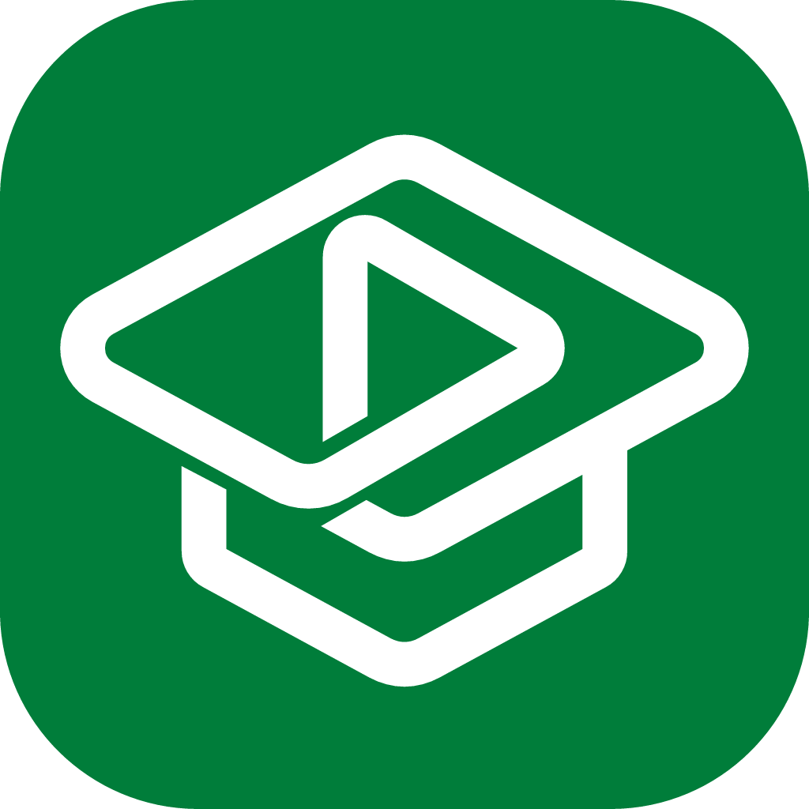

# moodle-mcp

<p align="center">
  
</p>

[English](README.md)

Un plugin de Claude Code que permite a Claude leer tu Moodle. Está hecho para Moodle Centros de Sevilla (Junta de Andalucía) con inicio de sesión de Acceso Único. No es oficial ni tiene relación con Moodle ni con la Junta.

## Qué hace

Pregunta con tus palabras, por ejemplo «¿qué tareas me faltan?» o «¿qué nota saqué en el último examen?».

| Herramienta | Qué te da                                                               |
| ----------- | ----------------------------------------------------------------------- |
| `pending`   | tareas sin entregar, incluidas las atrasadas                            |
| `list`      | todas las tareas con su estado                                          |
| `show`      | una tarea: instrucciones, archivos, fechas, entrega, nota y comentarios |
| `courses`   | tus cursos                                                              |
| `contents`  | secciones, actividades y archivos de un curso                           |
| `quizzes`   | cuestionarios con fechas e intentos usados                              |
| `grades`    | notas y totales                                                         |
| `upcoming`  | fechas de entrega del calendario                                        |
| `news`      | últimos mensajes de los foros                                           |
| `file`      | el contenido de un archivo del curso                                    |
| `login`     | renueva tu token de acceso                                              |

Nunca entrega ni modifica nada en Moodle.

## Requisitos

- [Claude Code](https://claude.com/claude-code)
- [Node.js](https://nodejs.org) 20 o superior
## Instalación

Ejecuta esto dentro de Claude Code:

```
/plugin marketplace add nyarw/moodle-mcp
```

```
/plugin install moodle@moodle-mcp
```

## Configuración

1. Escribe tu usuario (IdEA) y contraseña de Acceso Único cuando el plugin te los pida. Para cambiarlos después, abre `/plugin` y configura `moodle`.
2. Reinicia Claude Code.
3. Inicia sesión:

```
/moodle:login
```

Vuelve a ejecutarlo si una herramienta dice que tu token ha caducado.

## Tus datos

- La contraseña está marcada como dato sensible en los ajustes del plugin. Es la contraseña de toda tu cuenta educativa, no solo de Moodle.
- El token de acceso se guarda como un archivo sin cifrar en la carpeta de datos del plugin, dentro de `~/.claude/plugins/data/`, y se borra al desinstalar el plugin. Quien lo tenga puede leer tu Moodle.
- Lo que devuelven las herramientas pasa a tu conversación con Claude.

## Desarrollo

El servidor es `src/moodle.mjs`. El plugin ejecuta la versión empaquetada de `dist/`, así que tras un cambio vuelve a generarla y sube ambas:

```
npm install
```

```
npm run build
```

## Licencia

[MIT](LICENSE)
